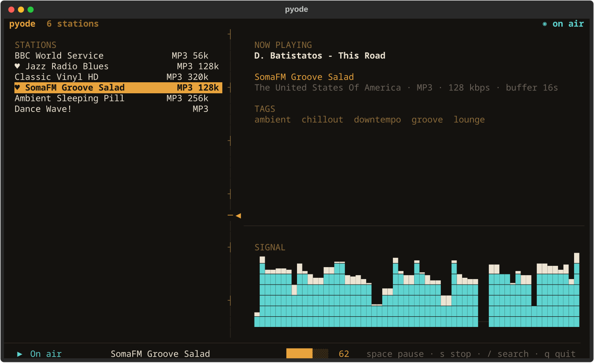

# pyode

A simple terminal internet radio player: a Textual TUI over libmpv, with a
station library kept in a plain CSV file and discovery via
[radio-browser.info](https://www.radio-browser.info/).



Stations on the left, what is on air on the right, and a signal meter that
reads the decoded stream — so it keeps moving even when you have it muted.

## Status

Complete and usable.

- [x] Phase 1 — player core (libmpv, ICY metadata, volume, error reporting)
- [x] Phase 2 — CSV station library (atomic writes, spreadsheet-safe)
- [x] Phase 3 — radio-browser.info API client
- [x] Phase 4 — Textual UI
- [x] Phase 5 — CLI polish

## Installation

Install libmpv for your platform (below), then install the Python application:

```bash
uv tool install pyode-radio
pyode
```

Or install into an activated Python virtual environment with `pip install pyode-radio`.
The distribution is named `pyode-radio` because [PyODE on PyPI](https://pypi.org/project/PyODE/)
is an unrelated physics library. Both installers create the `pyode` command automatically; no shell wrapper or
source checkout is needed. If uv's tool directory is not on PATH, run
`uv tool update-shell` and restart your shell.

To run unreleased changes, install from a checkout with `uv tool install .` or
`pip install .`. Either way, libmpv remains a separately installed native
dependency.

## Requirements

Python 3.12+ and **libmpv** — the shared library, which is not always the same
thing as the mpv player.

| Platform | Install |
| --- | --- |
| Arch / CachyOS | `sudo pacman -S mpv` |
| Debian / Ubuntu | `sudo apt install libmpv2` |
| Fedora | `sudo dnf install mpv-libs` |
| openSUSE | `sudo zypper install libmpv2` |
| macOS | `brew install mpv` |
| Windows | see below — installing mpv is *not* enough |

pyode finds the library itself, including in the places the dynamic loader
does not look on its own: Homebrew's `/opt/homebrew/lib` and `/usr/local/lib`,
MacPorts, Scoop and Chocolatey install trees, and the `lib` directory beside an
`mpv` binary on your `PATH`. No environment variable should be necessary.

If one is, `PYODE_LIBMPV` takes the library file or the directory holding it,
and `pyode --libmpv` prints every place that was searched and what was found
there — start there when playback will not begin.

### Windows

Every Windows mpv package — Scoop, Chocolatey, winget, and the official builds
— ships `mpv.exe` as a single statically linked binary containing **no libmpv
DLL**, so `scoop install mpv` alone will not get pyode running. Get the library
from the separate development build:

1. Download `mpv-dev-x86_64-<date>-git-<hash>.7z` (or `mpv-dev-aarch64-…` on
   Arm) from [zhongfly/mpv-winbuild releases][winbuild].
2. Extract `libmpv-2.dll` into `%LOCALAPPDATA%\pyode\lib`.

pyode searches that directory, so nothing else needs configuring. Run
`pyode --libmpv` to confirm it was picked up. WSL is not required.

[winbuild]: https://github.com/zhongfly/mpv-winbuild/releases/latest

#### Legacy SHOUTcast v1 stations

A handful of older stations (SLAY Radio, for one) run SHOUTcast v1 servers that
reply with a bare `ICY 200 OK` status line instead of `HTTP/1.1 200 OK`.
libcurl treats that as invalid (`Received HTTP/0.9 when not allowed`), while
ffmpeg accepts it. mpv 0.42 added a libcurl stream layer that, when a build
includes it, opens every `http://` URL first — Homebrew's mpv does — so on
those builds such stations fail with "loading failed" even though the URL is
fine.

pyode turns that layer off (mpv's `curl-enabled` option) wherever it exists, so
streams go through ffmpeg as they always did. Builds without it are unaffected.

The [zhongfly/mpv-winbuild][winbuild] libmpv for Windows also links libcurl. If
an ICY station still fails there, `pyode --play <url>` will show the error;
please report it, along with the libmpv build in use.

## Station library

Stations live in a CSV file at `~/.config/pyode/stations.csv` (override with
`PYODE_STATIONS_FILE`). It is meant to be edited by hand or in a spreadsheet;
unknown columns are ignored, missing ones take defaults, and a malformed row is
skipped rather than taking the rest of the file down with it.

You can edit the file while pyode is running. pyode notices within a couple
of seconds and reloads it, and before saving any change of its own it checks
again, so your edit is never overwritten with an older copy. If the edited
file cannot be read (saved in the wrong encoding, say), pyode says so and
refuses to save over it until it is fixed.

Favourites are a `favorite` column rather than a second file, so a station has
exactly one record and marking one cannot desynchronise from renaming or
deleting it. Reading accepts `true`/`yes`/`1`/`x`; writing is always
`true`/`false`.

## Command line

```bash
pyode                          # open the interface
pyode --station groove         # open playing the first match in your library
pyode --list                   # print the library and exit
pyode --history                # print recently heard tracks and exit
pyode --libmpv                 # report where libmpv was looked for, and exit
pyode --no-visualiser          # start with the signal meter hidden
pyode --keymap vim              # save Vim controls (arrows remain available)
pyode --keymap standard         # return to the standard controls
pyode --visualiser              # show the signal meter again
pyode --volume 60
pyode --stations ./other.csv   # use a different library file
pyode --play <url> --seconds 10 --silent   # headless, for testing a stream
```

`--list` writes the station names to stdout and a one-line summary to stderr,
so it pipes cleanly.

On the very first run — when the library file does not yet exist — pyode seeds
six varied stations so there is something to play immediately. Every seeded URL
was checked against a live decoder. Seeding keys on the file never having
existed, not on the library being empty: if you delete every station, it stays
deleted.

## Using it

Stations sit on the left, what is on air sits on the right, and the signal
meter is bottom right. The rule between the two panes is a tuning scale: the
needle marks where the playing station falls in your library.

| Key | Does |
| --- | --- |
| `↑` / `↓` (Vim: `k` / `j`) | Previous / next station |
| `→` / `p` / `Enter` (Vim: `l`) | Play the selected station |
| `space` | Pause and resume |
| `Shift+↑` / `Shift+↓` (Vim: `K` / `J`) | Move the selected station up / down the list |
| `←` / `s` (Vim: `h`) | Stop |
| `f` | Favourite the selected station |
| `F` (Shift+f) | Toggle favourites-only / all stations |
| `d` | Remove it from the library |
| `u` | Undo the last removal, restoring its position |
| `+` / `-` | Volume |
| `m` | Mute |
| `t` | Track history |
| `c` | Copy the current track title |
| `v` | Show or hide the signal meter |
| `/` | Browse or search the directory |
| `?` | Show controls for the active keymap |
| `q` | Quit |

The directory dialog opens on a short menu: popular stations, top voted, by
genre, and by country. Enter opens a list or adds the highlighted station, and
Escape goes back one level before it closes the dialog. Space plays the
highlighted station so you can hear it first; Space again stops it. When the
dialog closes, a station you added keeps playing, and otherwise pyode goes back
to whatever was playing before. Typing a name or tag
and pressing Enter searches instead. Down or Tab moves from the search box into
the list; up/down work there, and Vim mode adds j/k. Text fields retain normal
typing and cursor movement.
Playback and library shortcuts apply only to the main screen. Undo lasts for
this session and restores the station without restarting playback. Moving a
station while favourites are shown swaps it with the neighbouring favourite.

### Track history

Every track title a station announces is logged with the station and the time,
so "what was that?" has an answer. Press `t` to see the most recent first;
Enter or `c` copies the highlighted title, and `c` on the main screen copies
whatever is on air now. `pyode --history` prints the log for scripts.

The log is a CSV file (`history.csv` in the platform's pyode data directory,
or `PYODE_HISTORY_FILE`). pyode only appends to it and never trims it: it is
yours to keep, edit, or delete. Set `history = false` in `config.toml` to keep
history for the current session only, with nothing written to disk.

Copying uses the terminal's clipboard support (OSC 52), which works over SSH in
most terminals, and the local clipboard tool as well (`pbcopy`, `wl-copy`,
`xclip`, `xsel`, or `clip`) for terminals such as macOS Terminal that lack it.
Not every station announces titles; many send only their own name.

### When a stream fails

If a stream that was playing drops, pyode reconnects on its own, waiting a
little longer each time (1, 2, 4, 8, then 15 seconds) before giving up. A
connection that holds for 30 seconds earns a fresh set of attempts. A stream
that drops while paused waits for you to press space.

If a station from the directory fails to start at all, pyode looks it up
again by its directory ID. Station addresses change often; when the directory
has a new one, pyode saves it to your library and tries again.

### Preferences

The keymap, volume, signal meter visibility, and whether to save track history are saved in the platform's
pyode configuration directory (`~/.config/pyode/config.toml` on Linux).
Use `PYODE_CONFIG_FILE` to choose another path. For example:

```toml
keymap = "vim"
volume = 60
visualiser = true
history = true
```

CLI options override saved values and are remembered when the interface opens.
Volume and visualiser changes in the interface are saved immediately. Headless
playback and diagnostic commands do not change preferences. Invalid settings
produce an error identifying the file, so it can be corrected without losing it.

The meter plots signal level over time, not a frequency spectrum, because time
is what the player measures. It reads the decoded stream ahead of the volume
stage, so it keeps moving while muted — it tells you the stream is alive, not
that sound is coming out. A stalled stream flatlines.

Start with it hidden using `pyode --no-visualiser`.

## Station discovery

Stations come from [radio-browser.info](https://www.radio-browser.info/), a
free volunteer-run directory. pyode identifies itself by User-Agent, asks the
server to filter out broken streams, and reports plays back so the community's
popularity ranking stays useful. The mirror is found over DNS, falling back to
`de1.api.radio-browser.info`.

Browsing by genre lists the 100 tags with the most stations and matches the one
you pick exactly, so "rock" does not also bring in "80s rock" or "rockabilly".
A typed search matches tags loosely, which suits a search. Each list shows up
to 60 stations, most played first.

## Small terminals

Below 68 columns the metadata pane is dropped and the station list takes the
full width; below 20 rows the signal meter goes too. The list and the controls
are what the app cannot do without, so they are what survive.

## Development

```bash
uv sync
uv run pytest
uv run ruff check .
```

The entry point also provides a headless harness for testing streams:

```bash
uv run pyode --volume 65 --name "Smooth Jazz" --play <stream-url>
uv run pyode --silent --seconds 10 --play <stream-url>   # decode without an audio device
```

Build and check an installed release (requires network access for dependencies):

```bash
uv build --out-dir dist/0.3.0-radio
uv run python scripts/check_install.py dist/0.3.0-radio
```

See [the release procedure](docs/releasing.md) for PyPI setup and publishing.

## Licence

pyode is licensed under the GNU General Public License, version 2 or later.
See [LICENSE](LICENSE).

It plays audio through **libmpv** via `python-mpv`, which inherits libmpv's
licence — GPLv2-or-later on a stock build, LGPLv2.1-or-later if libmpv was
built that way. The remaining dependencies (Textual, httpx, platformdirs) are
MIT or BSD.
